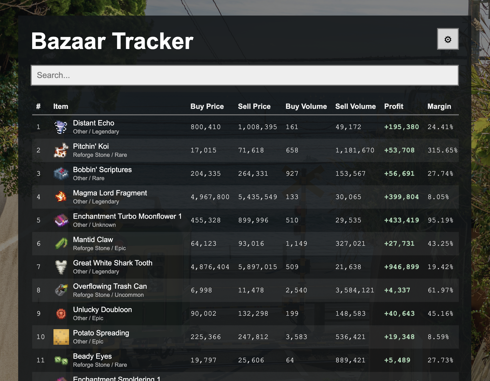

# Bazaar Tracker

Bazaar Tracker is a live Hypixel SkyBlock Bazaar tracker that helps find strong flips across the market.

**Live Demo:** https://bazaar-tracker-ten.vercel.app/

It uses custom metrics I developed:
1. **Gamma** measures opportunity using profit and market activity.
2. **Omega** measures stability and can optionally be factored into rankings.

## Features

- Pulls live Hypixel Bazaar data from the API
- Search by item
- Tax settings because the Bazaar taxes transactions
- Gamma and Omega rankings
- Item icons
- Adjustable number of results
- Background picker

## To run this locally

1. First, download or clone this repository:

   `git clone https://github.com/linjeffrey21-creator/BazaarTracker.git`

   `cd BazaarTracker`

2. Install the requirements:

   `pip install -r requirements.txt`

3. Extract the item icons:

   `python -m zipfile -e static/item_icons.zip static`

4. Run the app:

   `python app.py`

   If your system uses `python3` instead, use `python3 app.py`.

5. Open:

   `http://localhost:5050`

**Note:** You can ignore the `public/` folder when running locally. It contains copies of the background images for Vercel deployment. The local Flask app uses the original images in `static/backgrounds/`, so there is no need to move or modify anything inside `public/`.

## How it works

The tracker retrieves live Bazaar data from Hypixel's API and evaluates items based on their prices, profit margins, trading activity, and market stability.

By default, items are ranked using Gamma. However, you can factor in Omega, which incorporates the stability score into the ranking to help identify more balanced opportunities.

## Built with

Python, Flask, HTML, CSS, JavaScript, and the Hypixel API.

As a parting gift to the thousand hours I put into SkyBlock.
